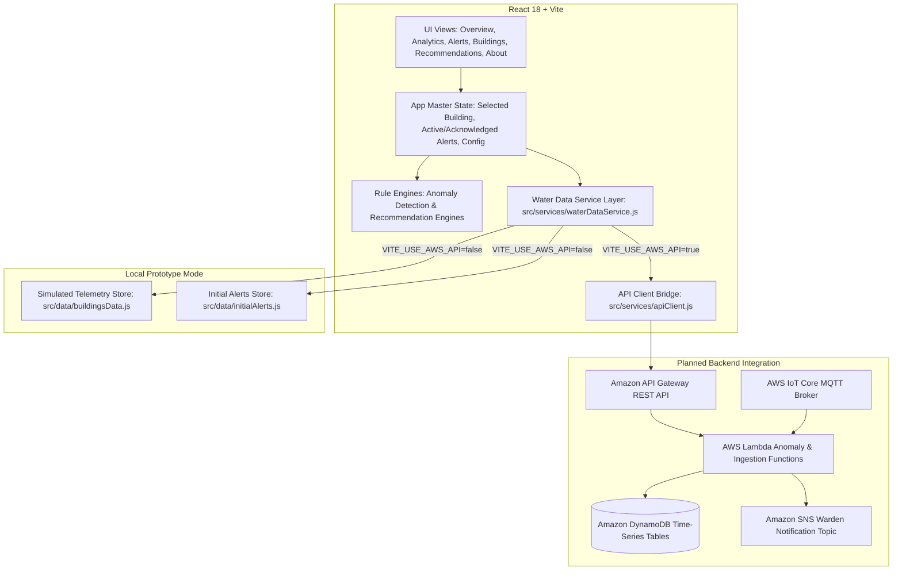

# AquaGuard — Architecture Documentation

**Platform:** AquaGuard — Smart Water Waste Detection & Conservation Platform  
**Hackathon:** Environmental Hacks 2026 (Track: Heat & Water)  
**Architecture Classification:** Decoupled Client-Side SPA with Pluggable Cloud Telemetry Bridge  

---

## 1. High-Level System Architecture

AquaGuard is engineered with a strict separation between UI presentation, analytical computation, and telemetry persistence. The prototype currently runs entirely client-side using deterministic simulated models, while exposing standard service contracts for direct integration with AWS serverless services.



---

## 2. Directory Structure & Module Breakdown

```text
AquaGuard/
├── src/
│   ├── components/
│   │   ├── common/
│   │   │   ├── Badge.jsx                  # Semantic severity and simulated data pill tags
│   │   │   └── StatCard.jsx               # KPI card with trend vectors and status accents
│   │   ├── DemoBanner.jsx                 # Prominent hackathon simulated data disclaimer
│   │   ├── Header.jsx                     # Topbar with building selector, timestamps & controls
│   │   ├── Sidebar.jsx                    # Desktop navigation, mobile drawer & health indicators
│   │   ├── SimulationControlsModal.jsx    # Interactive scenario injector & threshold sliders
│   │   └── TankVisualizer.jsx             # Cylindrical animated fluid reservoir component
│   ├── data/
│   │   ├── buildingsData.js               # Multi-facility synthetic telemetry & zone shares
│   │   └── initialAlerts.js               # Historical verified & acknowledged anomaly logs
│   ├── pages/
│   │   ├── AboutProject.jsx               # Problem, solution, limitations & roadmap
│   │   ├── Buildings.jsx                  # Comprehensive campus facility directory
│   │   ├── LeakAlerts.jsx                 # Transparent anomaly ledger & acknowledgment view
│   │   ├── Overview.jsx                   # Central command dashboard with KPIs & recent alerts
│   │   ├── Recommendations.jsx            # Contextual mitigation checklists & explanations
│   │   └── WaterAnalytics.jsx             # Diurnal flow curves, 7d/30d and cross-facility bars
│   ├── services/
│   │   ├── apiClient.js                   # Decoupled fetch wrapper for AWS API Gateway
│   │   └── waterDataService.js            # Unified data provider & simulation state manager
│   ├── utils/
│   │   ├── anomalyDetection.js            # Transparent mathematical rule evaluation logic
│   │   ├── calculations.js                # Aggregations, deviations, and campus health stats
│   │   └── recommendationsEngine.js       # Dynamic heuristic guidance generator
│   ├── App.jsx                            # Root layout, routing, notifications & modal coordinator
│   ├── main.jsx                           # React DOM mount point
│   └── index.css                          # Tailwind directives, animations & glassmorphism
├── docs/
│   ├── ARCHITECTURE.md                    # This document
│   ├── AWS_INTEGRATION_GUIDE.md           # Step-by-step AWS lead implementation manual
│   └── TESTING.md                         # Quality assurance results & testing protocols
├── AWS_LEAD_HANDOFF.md                    # Immediate briefing document for AWS teammate
├── .env.example                           # Configuration environment template
├── .gitignore                             # Repository exclusion rules
├── LICENSE                                # MIT open-source license
├── package.json                           # Dependency definitions & scripts
├── tailwind.config.js                     # Theme palette (Navy & Water cyan)
└── vite.config.js                         # Build pipeline & development server config
```

---

## 3. Core Architectural Principles

### 3.1. Complete Frontend Decoupling
The user interface does not know or care whether data originates from local synthetic generators or a remote cloud endpoint. All telemetry retrieval and mutation operations are funneled through `src/services/waterDataService.js`.

### 3.2. Transparent Rule-Based Anomaly Detection
Rather than opaque predictions, AquaGuard implements deterministic, explainable mathematical rules:
1. **Diurnal Moving Baseline:** Compares hourly telemetry to historical expected averages for that facility type.
2. **Relative Spike Delta:** Computes $\Delta \% = \frac{\text{Actual} - \text{Baseline}}{\text{Baseline}} \times 100$. If $\Delta \% \ge \text{threshold}$ (default: $+30\%$), an actionable anomaly is flagged.
3. **Storage Reserve Margins:** Monitors tank levels against configurable safety cutoffs ($25\%$ Advisory Warning, $15\%$ Critical Depletion).

### 3.3. Clear Simulated Data Guardrails
Per the design guidelines of Environmental Hacks 2026, no live physical hardware or automated campus savings are claimed. Every view visibly renders simulated data badges and explains the synthetic nature of the prototype.

---

## 4. Planned AWS Deployment Topology

When the AWS teammate integrates the cloud backend, the recommended architecture utilizes:
- **Hosting:** AWS Amplify Hosting or Amazon S3 + Amazon CloudFront for static web distribution.
- **API Layer:** Amazon API Gateway (HTTP/REST) with CORS enabled.
- **Compute:** AWS Lambda running Node.js 20 or Python 3.11.
- **Storage:** Amazon DynamoDB with a composite partition key (`buildingId` + `timestamp`).
- **Telemetry Ingestion:** AWS IoT Core receiving MQTT payloads from campus microcontrollers (ESP32 / LoRaWAN).
